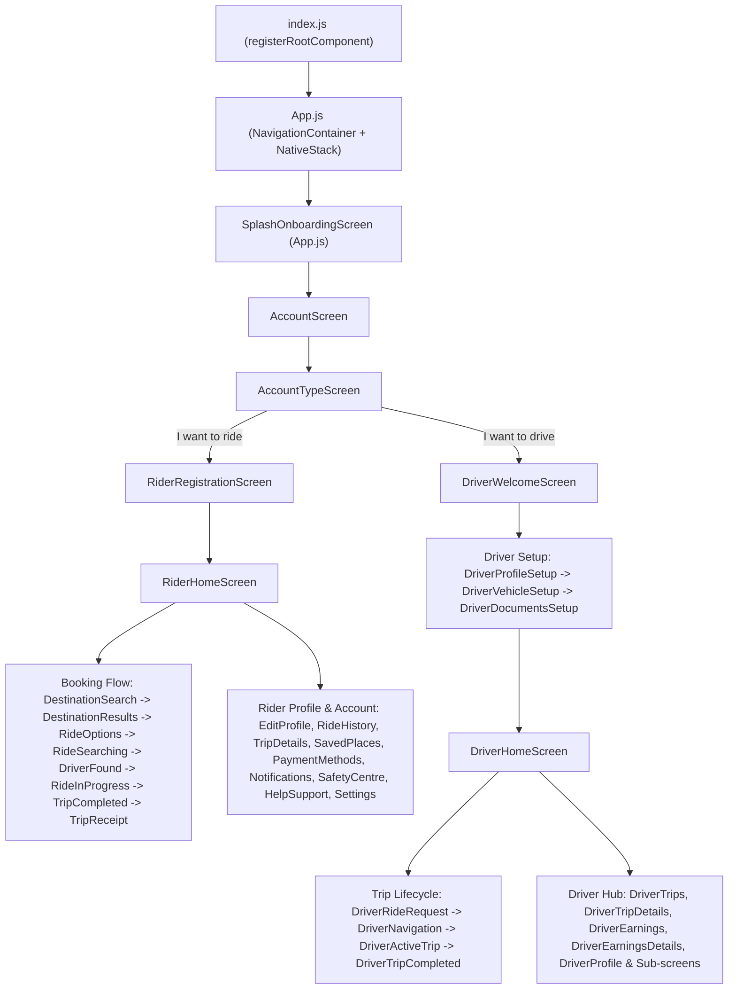

# RideGo


RideGo is a cross-platform mobile ride-hailing application built with **React Native** and **Expo** (SDK 57). It provides complete end-to-end user interfaces and navigation flows for both **Riders** (searching destinations, selecting ride tiers, tracking trips, and viewing receipts) and **Drivers** (onboarding, vehicle and document setup, accepting trip requests, navigating active trips, and tracking earnings).

---

## Table of Contents

- [Architecture Overview](#architecture-overview)
- [Features](#features)
- [Directory Structure](#directory-structure)
- [Tech Stack & Dependencies](#tech-stack--dependencies)
- [Getting Started (How to Run)](#getting-started-how-to-run)
- [Registered Navigation Routes](#registered-navigation-routes)
- [Configuration](#configuration)
- [License](#license)

---

## Architecture Overview


RideGo uses a single-root native stack architecture powered by `@react-navigation/native` and `@react-navigation/native-stack`:

1. **Application Entry (`index.js`)**: Registers the root component with `registerRootComponent(App)` from `expo`.
2. **Navigation Root (`App.js`)**: Hosts the `NavigationContainer` and `Stack.Navigator` (`initialRouteName="SplashOnboarding"`, `headerShown: false`), defining 44 screen routes across onboarding, rider, and driver domains.
3. **Screen Modules (`screens/`)**: 43 standalone screen components written in JavaScript using React Native core primitives (`View`, `Text`, `ScrollView`, `TouchableOpacity`, `TextInput`, `Animated`, `ActivityIndicator`), `expo-status-bar`, and `react-native-safe-area-context`.



---

## Features


### 1. Splash, Onboarding & Account Gateway
- **Animated Splash & Onboarding (`SplashOnboardingScreen`)**: Rotating orbital vehicle animation using React Native `Animated`, transitioning after 3 seconds into the onboarding screen with navigation to the account gateway.
- **Account Gateway (`AccountScreen`)**: Entry point for creating an account or signing in.
- **Role Selection (`AccountTypeScreen`)**: Allows users to choose between **Rider** (`RiderRegistration`) and **Driver** (`DriverWelcome`) flows.

### 2. Rider Experience
- **Rider Dashboard (`RiderHomeScreen`)**: Initial loading state, current location card, destination search trigger, and profile shortcut.
- **Destination & Ride Selection**:
  - `DestinationSearchScreen` & `DestinationResultsScreen` for picking destinations and saved places.
  - `RideOptionsScreen` offering 5 ride tiers (**Economy**, **Comfort**, **Business**, **Luxury**, **XL**) with ETA estimates and ZAR (`R`) pricing.
- **Live Trip Lifecycle**: `RideSearchingScreen` -> `DriverFoundScreen` -> `RideInProgressScreen` -> `TripCompletedScreen` -> `TripReceiptScreen`.
- **Rider Account & Support**:
  - Profile management (`RiderProfileScreen`, `EditProfileScreen`)
  - History & receipts (`RideHistoryScreen`, `TripDetailsScreen`, `TripReceiptScreen`)
  - Saved locations & payments (`SavedPlacesScreen`, `PaymentMethodsScreen`)
  - Alerts, safety, and preferences (`NotificationsScreen`, `SafetyCentreScreen`, `HelpSupportScreen`, `SettingsScreen`)

### 3. Driver Experience
- **Driver Onboarding Pipeline**: `DriverWelcomeScreen` -> `DriverProfileSetupScreen` -> `DriverVehicleSetupScreen` -> `DriverDocumentsSetupScreen`.
- **Driver Dashboard & Trip Execution**:
  - `DriverHomeScreen` with driver availability status card, go-online call to action, and bottom navigation shortcuts to Trips, Earnings, and Profile.
  - `DriverRideRequestScreen` -> `DriverNavigationScreen` -> `DriverActiveTripScreen` -> `DriverTripCompletedScreen`.
- **Trips, Earnings & Fleet Management**:
  - Trip log and per-trip inspection (`DriverTripsScreen`, `DriverTripDetailsScreen`).
  - Earnings summaries across Today, This Week, and This Month with RideGo platform fee breakdown (`DriverEarningsScreen`, `DriverEarningsDetailsScreen`).
  - Driver account settings (`DriverProfileScreen`, `DriverEditProfileScreen`, `DriverVehicleScreen`, `DriverDocumentsScreen`, `DriverNotificationsScreen`, `DriverSafetyScreen`, `DriverHelpScreen`, `DriverSettingsScreen`).

---

## Directory Structure


```text
ride-go/
├── .claude/
│   └── settings.json                  # Claude Expo plugin configuration
├── assets/
│   ├── android-icon-background.png    # Android adaptive icon background layer
│   ├── android-icon-foreground.png    # Android adaptive icon foreground layer
│   ├── android-icon-monochrome.png    # Android monochrome icon layer
│   ├── favicon.png                    # Web favicon asset
│   ├── icon.png                       # App icon asset
│   └── splash-icon.png                # Splash screen icon asset
├── screens/                           # 43 modular screen components
│   ├── AccountScreen.js
│   ├── AccountTypeScreen.js
│   ├── DestinationResultsScreen.js
│   ├── DestinationSearchScreen.js
│   ├── DriverActiveTripScreen.js
│   ├── DriverDocumentsScreen.js
│   ├── DriverDocumentsSetupScreen.js
│   ├── DriverEarningsDetailsScreen.js
│   ├── DriverEarningsScreen.js
│   ├── DriverEditProfileScreen.js
│   ├── DriverFoundScreen.js
│   ├── DriverHelpScreen.js
│   ├── DriverHomeScreen.js
│   ├── DriverNavigationScreen.js
│   ├── DriverNotificationsScreen.js
│   ├── DriverProfileScreen.js
│   ├── DriverProfileSetupScreen.js
│   ├── DriverRideRequestScreen.js
│   ├── DriverSafetyScreen.js
│   ├── DriverSettingsScreen.js
│   ├── DriverTripCompletedScreen.js
│   ├── DriverTripDetailsScreen.js
│   ├── DriverTripsScreen.js
│   ├── DriverVehicleScreen.js
│   ├── DriverVehicleSetupScreen.js
│   ├── DriverWelcomeScreen.js
│   ├── EditProfileScreen.js
│   ├── HelpSupportScreen.js
│   ├── NotificationsScreen.js
│   ├── PaymentMethodsScreen.js
│   ├── RideHistoryScreen.js
│   ├── RideInProgressScreen.js
│   ├── RideOptionsScreen.js
│   ├── RiderHomeScreen.js
│   ├── RiderProfileScreen.js
│   ├── RiderRegistrationScreen.js
│   ├── RideSearchingScreen.js
│   ├── SafetyCentreScreen.js
│   ├── SavedPlacesScreen.js
│   ├── SettingsScreen.js
│   ├── TripCompletedScreen.js
│   ├── TripDetailsScreen.js
│   └── TripReceiptScreen.js
├── .gitignore                         # Git ignore rules (node_modules, .expo, native dirs, .agents)
├── AGENTS.md                          # Expo SDK v57 documentation reference
├── App.js                             # Root Stack.Navigator & SplashOnboardingScreen
├── CLAUDE.md                          # Points to AGENTS.md
├── LICENSE                            # MIT License
├── README.md                          # Project documentation
├── app.json                           # Expo app manifest and platform icon settings
├── index.js                           # Expo root component entry point
├── package-lock.json                  # Exact dependency lockfile
└── package.json                       # Project scripts and package dependencies
```

---

## Tech Stack & Dependencies

| Package | Version | Purpose |
| :--- | :--- | :--- |
| `expo` | `~57.0.20` | Expo managed runtime and CLI toolchain |
| `react` | `19.2.3` | Core UI library |
| `react-native` | `0.86.3` | Native mobile UI framework |
| `@react-navigation/native` | `^7.3.18` | Navigation container and state management |
| `@react-navigation/native-stack` | `^7.18.10` | Native stack screen transitions |
| `react-native-safe-area-context` | `~5.7.0` | Safe area inset handling across devices |
| `react-native-screens` | `~4.26.0` | Native screen primitives for React Navigation |
| `expo-status-bar` | `~57.0.1` | Cross-platform status bar control |

---

## Getting Started (How to Run)


### Prerequisites

1. **Node.js & npm**: Install Node.js (LTS recommended) and npm.
2. **Mobile Testing Environment** (choose one):
   - **Physical Device**: Install the **Expo Go** app from Google Play Store (Android) or Apple App Store (iOS) on the same Wi-Fi network as your development machine.
   - **Android Emulator**: Android Studio with an Android Virtual Device (AVD) running.
   - **iOS Simulator** (macOS only): Xcode with an iOS Simulator installed.

### Installation

Clone the repository, move into the project directory, and install dependencies from `package-lock.json`:

```bash
git clone git@github.com:MphoVersace/ride-go.git
cd ride-go
npm ci
```

> If `package-lock.json` differs or you prefer standard resolution, use `npm install`.

### Running the Application

Start the Expo Metro bundler:

```bash
npm start
```

Or target a specific platform directly using the scripts defined in `package.json`:

| Command | Script | Description |
| :--- | :--- | :--- |
| `npm start` | `expo start` | Starts Metro bundler and prints QR code for Expo Go |
| `npm run android` | `expo start --android` | Opens the app in a connected Android device or emulator |
| `npm run ios` | `expo start --ios` | Opens the app in the iOS Simulator (macOS only) |
| `npm run web` | `expo start --web` | Starts the web target (requires `react-native-web` and `react-dom` if not yet installed) |

> **Note on Web Target**: `package.json` includes `react-native` and `expo` for Android and iOS out of the box (`sdkVersion: 57.0.0`). If you want to run `npm run web`, install the web dependencies first with `npx expo install react-dom react-native-web`.

Useful Expo CLI flags:

```bash
# Clear Metro bundler cache if assets or routes behave unexpectedly
npx expo start -c

# Pin Metro to a specific port
npx expo start --port 8082
```

---

## Registered Navigation Routes

All 44 routes are registered in `App.js` inside `Stack.Navigator` with `initialRouteName="SplashOnboarding"`:

| Category | Route Names |
| :--- | :--- |
| **Onboarding & Auth** | `SplashOnboarding`, `Account`, `AccountType`, `RiderRegistration` |
| **Rider Core & Booking** | `RiderHome`, `DestinationSearch`, `DestinationResults`, `RideOptions`, `RideSearching`, `DriverFound`, `RideInProgress`, `TripCompleted`, `TripReceipt` |
| **Rider Profile & Account** | `RiderProfile`, `EditProfile`, `RideHistory`, `TripDetails`, `SavedPlaces`, `PaymentMethods`, `Notifications`, `SafetyCentre`, `HelpSupport`, `Settings` |
| **Driver Onboarding** | `DriverWelcome`, `DriverProfileSetup`, `DriverVehicleSetup`, `DriverDocumentsSetup` |
| **Driver Trips & Operations** | `DriverHome`, `DriverRideRequest`, `DriverNavigation`, `DriverActiveTrip`, `DriverTripCompleted`, `DriverTrips`, `DriverTripDetails` |
| **Driver Earnings & Profile** | `DriverEarnings`, `DriverEarningsDetails`, `DriverProfile`, `DriverEditProfile`, `DriverVehicle`, `DriverDocuments`, `DriverNotifications`, `DriverSafety`, `DriverHelp`, `DriverSettings` |

---

## Configuration

Manifest settings in `app.json`:

- **App Name / Slug**: `ride-go` (`version`: `1.0.0`)
- **Orientation**: `portrait`
- **UI Style**: `light`
- **Android Adaptive Icon**: Configured with `#E6F4FE` background plus foreground, background, and monochrome layers in `assets/`
- **iOS**: `supportsTablet: true`
- **Web**: Uses `./assets/favicon.png`

---

## License

This project is licensed under the MIT License. See [LICENSE](./LICENSE) for details.
